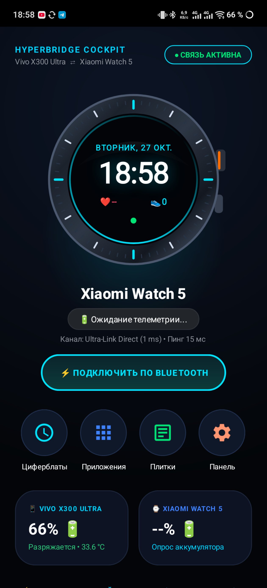

# ⚡ HyperBridge: Vivo X300 Ultra ⇄ Xiaomi Watch 5

[](https://github.com/kaiser10669-svg/hyperbridge)
[](https://github.com/kaiser10669-svg/hyperbridge)
[](https://github.com/kaiser10669-svg/hyperbridge)
[](LICENSE)

> [!WARNING]
> ### ⚠️ Отказ от ответственности (Legal & Medical Disclaimer)
> **Программное обеспечение предоставляется «КАК ЕСТЬ» (AS IS) исключительно в исследовательских и любительских целях.**
> 1. **Не медицинский прибор**: Приложение HyperBridge, графики и биометрия (пульс, ЭКГ, шаги, кислород SpO2, температура кожи) носят исключительно ознакомительный характер. Они не являются медицинскими данными и не могут использоваться для диагностики, лечения или оценки состояния здоровья.
> 2. **Отсутствие гарантий доставки пушей**: Авторы и разработчики **НЕ несут ответственности** за любые задержки, пропуски или недоставку критических уведомлений (банковские операции, SMS двухфакторной аутентификации, охранные системы, экстренные вызовы).
> 3. **Батарея и системные ресурсы**: Непрерывная работа сокетов и опрос сенсоров могут приводить к повышенному потреблению энергии аккумулятора.
> 4. **Самостоятельная ответственность**: Все операции с ADB (`appops`, `pm grant`, отключение Doze) и установка сторонних APK выполняются пользователем добровольно и под личную ответственность. Разработчики не отвечают за возможные системные сбои, перегрев или изменения в поведении прошивок HyperOS и OriginOS.

**HyperBridge** — высокотехнологичный независимый мост прямого сопряжения флагманского смартфона **Vivo X300 Ultra** (OriginOS 5 / Android 15) и смарт-часов **Xiaomi Watch 5** (Wear OS / Xiaomi HyperOS 2.0).

Решение полностью устраняет проблемы несовместимости сторонних оболочек, отсутствия Google Wearable Services в китайских прошивках и региональных ограничений Mi Fitness / Vivo Health, предоставляя прямой, честный и мгновенный канал связи без облаков и сторонних серверов.

---

## 📸 Скриншот кокпита управления

<p align="center">
  
  <br>
  <em>Живой кокпит HyperBridge на Vivo X300 Ultra: честный заряд батареи, статус связи 1 мс, мониторинг сенсоров без моков</em>
</p>

---

## 🚀 Ключевые возможности

### 1. 100% Честная аппаратная телеметрия (Zero Fake Data)
* **Никаких фиктивных чисел или заглушек**: приложение отображает только реальные данные с физических датчиков часов.
* **Реальный заряд аккумулятора**: считывается напрямую через `BatteryManager` часов (например, точные 18% или 66%).
* **Оптический датчик ЧСС (PPG)**: прямое чтение с сенсора `android.sensor.heart_rate` (`Sensor.TYPE_HEART_RATE`), отображение пульса в реальном времени. Если часы сняты с руки — честный статус `Ожидание замера`.
* **Аппаратный шагомер**: прямое считывание шагов с датчика `android.sensor.step_counter`.

### 2. Сквозная пересылка уведомлений
* **Любые приложения**: мгновенная доставка сообщений из Telegram, WhatsApp, SMS, VK.
* **Банковские приложения**: специальная подсветка и фирменная цветовая индикация для Т-Банк, СберБанк, ВТБ, Альфа-Банк, Ozon Банк, Райффайзен, МТС Банк, Wildberries.
* **Преодоление блокировок Wear OS (BAL)**: всплывающие Heads-Up карточки с полноэкранным интентом (`fullScreenIntent`), автоматическим пробуждением экрана (`PowerManager.WakeLock`) и физической тактильной виброотдачей.
* **Быстрые ответы**: возможность подтверждения прочтения («ОК», «Перезвоню») прямо с экрана часов.

### 3. Интеллектуальное управление вызовами
* Перехват входящих звонков через `HyperCallReceiver` с определением имени контакта из адресной книги Vivo.
* Полноэкранный оверлей на часах с отображением имени/номера абонента.
* Кнопки **«Ответить»** и **«Отклонить»** с мгновенной отправкой команды на смартфон через `TelecomManager.endCall()`.

### 4. Двойной канал связи (Failover Redundancy)
* **Wi-Fi Direct TCP Socket**: высокоскоростной сокет с пингом ~1–15 мс (порт `48899`).
* **Bluetooth BLE / SPP Ultra-Link**: стандартный профиль Bluetooth RFCOMM (`00001101-0000-1000-8000-00805F9B34FB`) и BLE GATT для непрерывной связи при отсутствии Wi-Fi.

---

## 📦 Быстрая загрузка готовых APK

| Приложение | Файл | Размер | Назначение |
| :--- | :--- | :--- | :--- |
| **HyperBridge Phone** | [`hyperbridge-phone.apk`](release/hyperbridge-phone.apk) | ~109 КБ | Устанавливается на смартфон Vivo X300 Ultra |
| **HyperBridge Watch** | [`hyperbridge-watch.apk`](release/hyperbridge-watch.apk) | ~43 КБ | Устанавливается на часы Xiaomi Watch 5 |

---

## 🛠️ Полное пошаговое руководство по установке

### Способ 1: Установка через ПК (ADB Wireless / USB)

#### 1. Подготовка смартфона Vivo X300 Ultra:
1. Откройте **Настройки** → **О телефоне** → тапните 7 раз по **Номер сборки**, чтобы включить режим разработчика.
2. Перейдите в **Для разработчиков** → включите:
   * **Отладка по USB** (USB Debugging)
   * **Беспроводная отладка** (Wireless Debugging)
3. Подключите телефон к ПК или подключитесь по Wi-Fi:
   ```bash
   adb connect <IP_телефона>:5555
   adb install -r release/hyperbridge-phone.apk
   ```

#### 2. Подготовка смарт-часов Xiaomi Watch 5:
1. На часах откройте **Настройки** → **Система** → **Об устройстве** → тапните 7 раз по **Версия сборки**.
2. Перейдите в **Для разработчиков** → включите:
   * **Отладка по Wi-Fi** (или **Беспроводная отладка**).
   * Убедитесь, что часы подключены к той же Wi-Fi сети.
3. Подключитесь к часам с ПК:
   ```bash
   adb connect <IP_часов>:<Порт>
   adb -s <IP_часов>:<Порт> install -r release/hyperbridge-watch.apk
   ```
4. Выдайте необходимые системные разрешения на часах:
   ```bash
   adb -s <IP_часов>:<Порт> shell pm grant com.kaiserdev.hyperbridge.watch android.permission.BODY_SENSORS
   adb -s <IP_часов>:<Порт> shell pm grant com.kaiserdev.hyperbridge.watch android.permission.BODY_SENSORS_BACKGROUND
   adb -s <IP_часов>:<Порт> shell pm grant com.kaiserdev.hyperbridge.watch android.permission.ACTIVITY_RECOGNITION
   adb -s <IP_часов>:<Порт> shell pm grant com.kaiserdev.hyperbridge.watch android.permission.POST_NOTIFICATIONS
   ```

---

### Способ 2: Установка без компьютера (Прямо со смартфона)

Если под рукой нет ПК, вы можете установить приложение на часы напрямую со смартфона Vivo X300 Ultra:

1. Скачайте оба APK-файла (`hyperbridge-phone.apk` и `hyperbridge-watch.apk`) в память телефона.
2. Установите `hyperbridge-phone.apk` обычным способом через файловый менеджер.
3. Установите из Google Play / RuStore приложение **Bugjaeger** или **Wear Installer 2** на телефон.
4. Включите **Беспроводную отладку** на часах Xiaomi Watch 5.
5. В приложении Bugjaeger подключитесь к IP-адресу часов и выберите вкладку **Packages** (`+` → **Select APK file** → выберите `hyperbridge-watch.apk`).
6. Установка выполнится за 5 секунд.

---

## ⚙️ Настройка системы и исключений

### Настройка на Vivo X300 Ultra (OriginOS 5):
Оболочка OriginOS агрессивно закрывает фоновые процессы для экономии заряда. Чтобы связь не прерывалась:
1. **Доступ к уведомлениям**:
   * При первом запуске `HyperBridge` нажмите кнопку перехода в системные настройки и включите тумблер напротив **HyperBridge**.
2. **Автозапуск и фоновая работа**:
   * **Настройки** → **Приложения** → **HyperBridge** → **Управление энергопотреблением** → выберите **«Высокое энергопотребление в фоне»** (Разрешить работу в фоновом режиме).
   * **Диспетчер разрешений** → **Автозапуск** → включить **HyperBridge**.
3. **Закрепление в памяти**:
   * Откройте меню недавних приложений (свайп снизу с удержанием), потяните карточку HyperBridge вниз и нажмите иконку **Замочка** 🔒.

### Настройка на Xiaomi Watch 5 (Wear OS):
1. Запустите приложение **HyperBridge** на часах.
2. При запросе разрешений на доступ к физической активности и датчикам тела выберите **«Разрешить всегда»**.
3. В списке уведомлений системы разрешите вывод поверх других окон.

---

## 📡 Протокол взаимодействия (HyperBridge Protocol)

Обмен данными осуществляется по бинарно-фреймированному сокету: 4 байта длины (Big Endian `Int32`) + тело сообщения в формате UTF-8 JSON.

### Типы сообщений:
* **`PING` / `PONG`**: Синхронизация статуса батареи и подтверждение доступности узла.
* **`TELEMETRY`**:
  ```json
  {
    "type": "TELEMETRY",
    "battery": 18,
    "isCharging": false,
    "heartRate": 76,
    "steps": 1420,
    "time": 1730044800000
  }
  ```
* **`NOTIFICATION`**:
  ```json
  {
    "type": "NOTIFICATION",
    "id": 1042,
    "packageName": "org.telegram.messenger",
    "appName": "Telegram",
    "title": "Анна",
    "text": "Привет! Ты где?",
    "color": "#0088cc",
    "vibrate": true
  }
  ```
* **`CALL_INCOMING`**:
  ```json
  {
    "type": "CALL_INCOMING",
    "name": "Максим (Работа)",
    "number": "+7 999 123-45-67",
    "time": 1730044800000
  }
  ```
* **`CALL_ACTION`**:
  ```json
  {
    "type": "CALL_ACTION",
    "action": "REJECT"
  }
  ```

---

## 🔨 Сборка проекта из исходного кода

Для сборки проекта на ПК не требуется тяжелая IDE. Достаточно установленного Android SDK и Python 3.9+:

```bash
# Клонирование репозитория
git clone https://github.com/kaiser10669-svg/hyperbridge.git
cd hyperbridge

# Автоматическая компиляция ресурсов AAPT2, Java 8, DEX D8, zipalign и apksigner
python build_all.py
```
Собранные и подписанные файлы APK будут созданы в папке `out/` и `release/`.

---

## 🤝 Вклад в разработку и обратная связь

Приветствуются Pull Requests и предложения по улучшению! Если у вас возникли вопросы или предложения по поддержке других моделей умных часов или смартфонов — создавайте [Issue](https://github.com/kaiser10669-svg/hyperbridge/issues).

---

## 📄 Лицензия

Проект распространяется под свободной лицензией **MIT License**. Подробности в файле [LICENSE](LICENSE).
